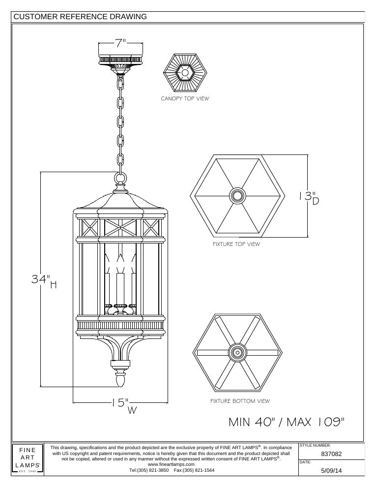
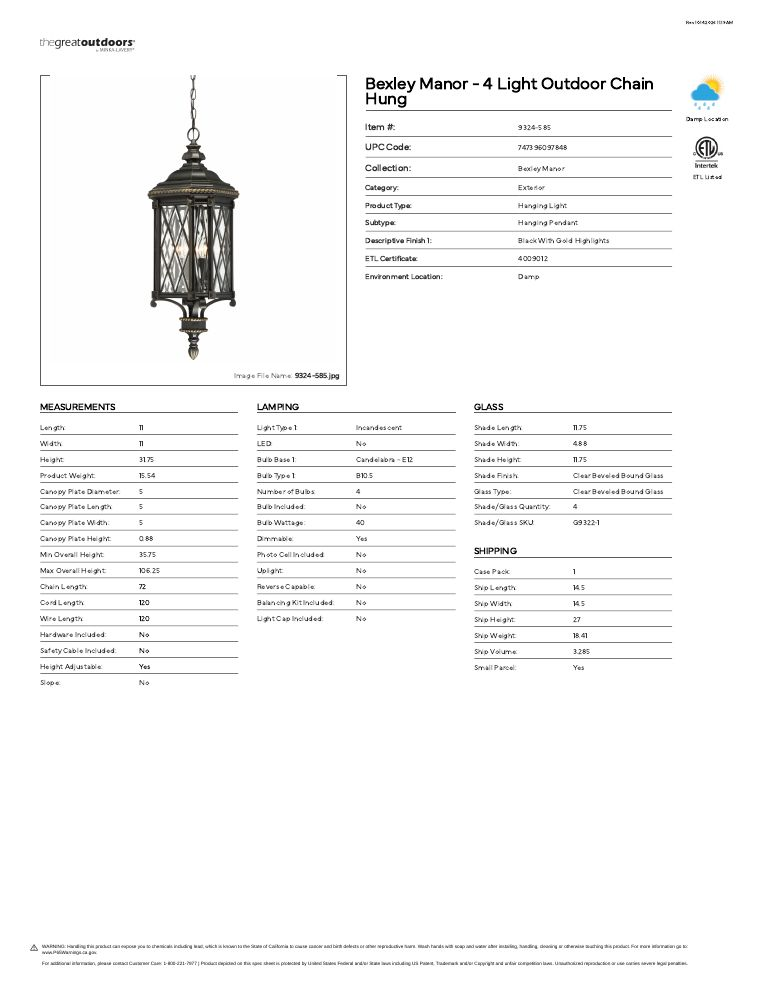
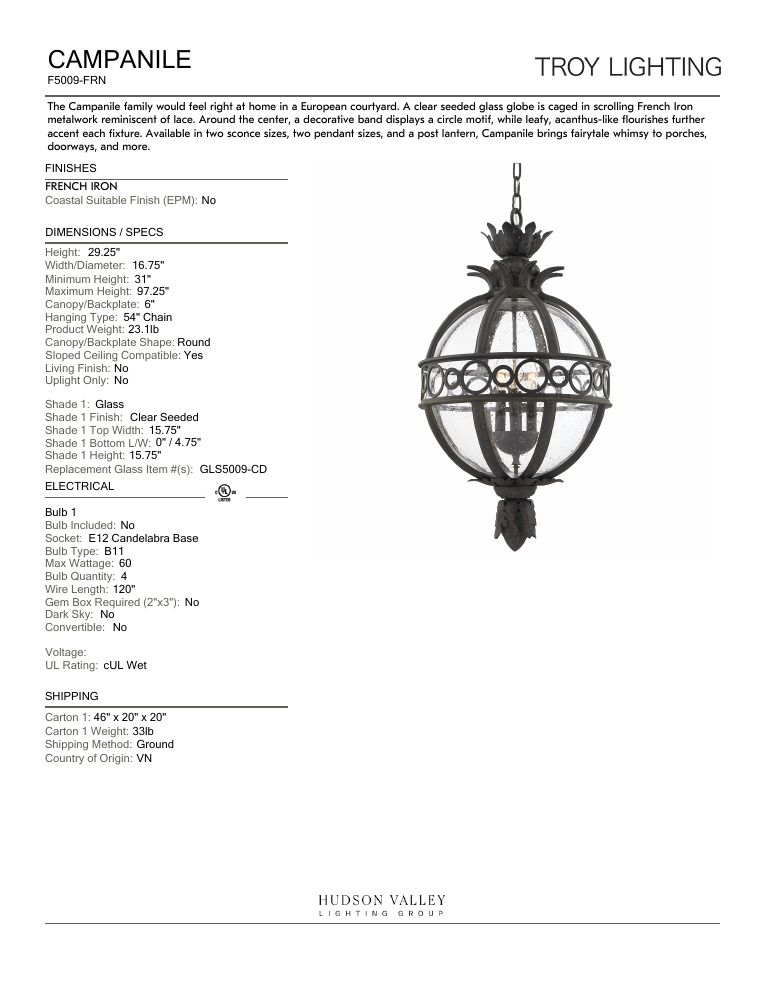
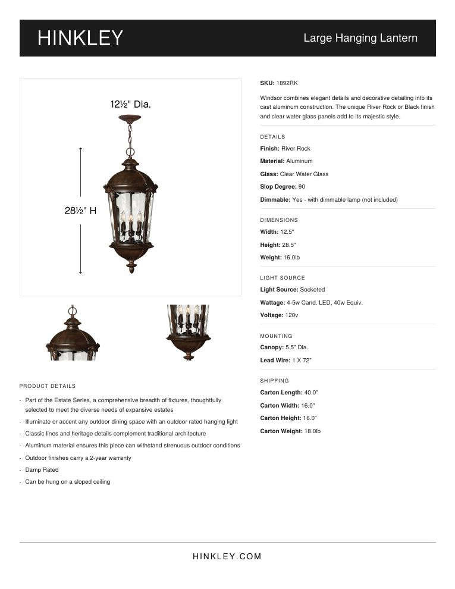
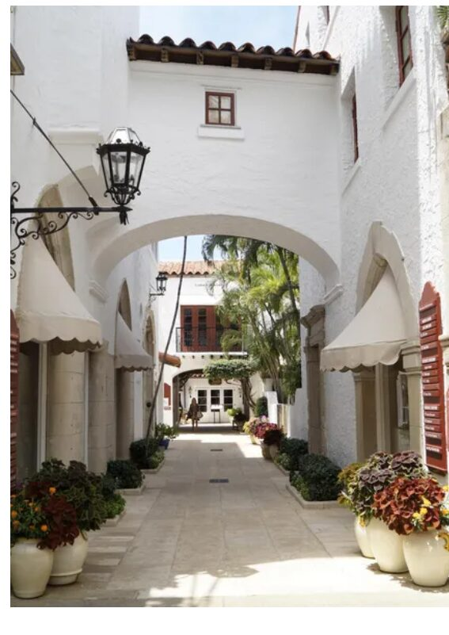

# 125 Worth Avenue: Loggia Lighting, Round 2 Lantern Options

- **Source folder:** `sources/2026-11-18_lantern-options-round-2/`
- **Received:** November 18, 2026, 8:30 AM. Michael Cabrera forwarded Raquel Swearingen's November 17 revisions.
- **Keywords:** lanterns, pendants, sconces, step lights, photometrics, footcandles, property line, Mizner, Remains Lighting, Fine Art Lamps, Hinkley, Troy, Hudson Valley, Bexley Manor, Great Outdoors, Minka Lavery, beam detail, north interior loggia elevation

## Action items (Michael Cabrera, Nov 18)

- **Johnathan and Richard:** select one of the Round 2 lantern options and add it to the **North interior loggia elevation**, together with the **beam detail** Richard is developing.
- The team needs an **enlarged section of the beam detail** to add to the drawings, and for **Svetlana to use as a reference for the rendering**.
- The email went to Richard, Johnathan, William, Murat, Anne and Svetlana.

## Email thread (oldest first)

**Nov 17, 9:35 AM, Michael to Raquel** (cc Danele Spoden, Murat Saryyev). Michael asked for the loggia fixture options by 2:00 PM for a 2:30 PM materials review meeting with Ownership.

**Nov 17, 12:10 PM, Raquel to Michael. Round 1 photometrics and fixture schedule.**
- She used very low wattage lamps in the lanterns (**3W**) because the property line is so close. The town does not allow more than **0.5 footcandles over the property line**.
- As a result the loggia is dim: about **2 footcandles**, where 5 to 10 is typical. She recommended submitting and installing as shown, and swapping in higher-wattage lamps later if tenants find it too dim.
- She recommended keeping **the same size lanterns throughout**. Larger lanterns at the main entrance would likely have **4 lamps instead of 3** and spill too much light over the property line.
- She moved the **F2 step lights** to the interior side of the columns to reduce spill over the property line.

**Nov 17, 2:55 PM, Michael to Raquel. Feedback from Richard and Ownership.**
- **Step lights:** asked for a recessed option. With the new piers, step lights can be flush or recessed instead of wall-mounted.
- **Hanging pendants:** Richard found the selections too simplified and lacking the detail found throughout Worth Ave. To go over better with the architectural commissions, he wants options that are more true to the style and more ornate, not diluted. Suggested references: **Remains Lighting**, the Bonnet House article on Mizner lanterns and their replicas (bonnethouse.org/from-the-collections-vault-mizner-lanterns-and-their-replicas/), and the Remains blog on Addison Mizner artisanship (remains.com/blogs/blog/blog-addison-mizner-award-winning-artisanship).

**Nov 17, 4:47 PM, Raquel to Michael** (cc Whitney Robinette of L3 Capital, Danele Spoden, Murat Saryyev, Richard Sammons). Sent revisions: added recessed step light options, and redid the lantern and sconce selections based on the feedback. She wanted time to refine before **Friday** (November 20, 2026).

**Nov 18, 8:30 AM, Michael to the team.** Forwarded the Round 2 lanterns with the action items above. The email had 7 attachments; the 4 lantern spec sheets are archived here.

## The four Round 2 lanterns

### 1. Fine Art Lamps, Style 837082

- Customer reference drawing dated 5/09/14. Fine Art Lamps (est. 1940), (305) 821-3850.
- **34" H x 15" W**, 13" across the flats (hexagonal).
- Canopy 7".
- Overall hanging height: min 40", max 109".
- Chain hung, with a crown cap and a tapered bottom on scroll brackets.
- **Not on the sheet:** finish, material, lamp count, wattage, wet/damp rating. Confirm it's still in production (drawing is from 2014).

### 2. Bexley Manor 9324-585 (The Great Outdoors / Minka Lavery)

- 4-light outdoor chain-hung pendant. Finish: black with gold highlights.
- **31.75" H x 11" W x 11" L**. Weight 15.54 lb.
- Canopy 5" diameter.
- Chain 72", wire 120". Overall height: min 35.75", max 106.25".
- **4 x 40W candelabra (E12) B10.5 incandescent**, dimmable.
- Clear beveled bound glass, 4 panels (replacement SKU G9322-1).
- Damp rated, ETL listed (certificate 4009012). UPC 747396097848.

### 3. Troy Lighting Campanile F5009-FRN (Hudson Valley Lighting Group)

- Clear seeded glass globe caged in scrolling French Iron metalwork with a circle-motif band and acanthus-like leaves. Finish: French Iron.
- **29.25" H x 16.75" diameter**. Weight 23.1 lb.
- Canopy 6", round.
- 54" chain, 120" wire. Overall height: min 31", max 97.25". Sloped ceiling compatible.
- **4 x E12 candelabra B11, 60W max.**
- Replacement glass GLS5009-CD. cUL Wet rated. Made in Vietnam.
- **Coastal suitable finish (EPM): No.**

### 4. Hinkley Windsor 1892RK, Large Hanging Lantern (Estate Series)

- Cast aluminum. Finish: River Rock (also Black). Clear water glass.
- **28.5" H x 12.5" W**. Weight 16.0 lb.
- Canopy 5.5" diameter. Lead wire 72". Fits sloped ceilings up to 90 degrees.
- Socketed; **4 to 5W candelabra LED (40W equivalent)**, 120V, dimmable with a dimmable lamp.
- Damp rated. 2-year warranty on outdoor finishes.

## Comparison and recommendation (Svetlana and Claude, Nov 18)

| Option | Size | Style | Concerns |
|---|---|---|---|
| Fine Art Lamps 837082 | 34"H x 15"W | Hexagonal cage, crown cap, scroll-bracket base. The closest match to the Mizner / Remains / Via Mizner references | Sheet has no finish, lamp count or rating; check availability |
| Hinkley Windsor 1892RK | 28.5"H x 12.5"W | Traditional, but reads as a mass-produced cast piece | Best for salt air (aluminum, LED); good backup |
| Troy Campanile F5009-FRN | 29.25"H x 16.75"W | Ornate, but the French lace globe reads French, not Spanish/Mediterranean | Not coastal-rated; 4 lamps |
| Bexley Manor 9324-585 | 31.75"H x 11"W | Round, diamond-pattern glass; least detailed | 4 lamps, damp only |

**Leading pick:** Fine Art Lamps 837082. It also resembles the hanging lantern in the slide 29 reference (wood-beam arcade).

**Open questions for Raquel / Fine Art Lamps:**
1. Finish options (aged iron or bronze?) and material.
2. Lamp count and whether it works with the 3W lamping and the 0.5 fc property-line limit. 4-lamp fixtures were flagged as a spill risk.
3. Wet/damp and coastal rating.
4. Availability and lead time (drawing dated 2014).
5. Hang height and chain length to clear the bottom of the new loggia beams.

## Rendering reference: Via Mizner

`sources/2026-11-18_lantern-options-round-2/reference_via_mizner_lantern.png` is a photo of a Palm Beach via: white stucco walls, a red tile roof, a stucco arch spanning the passage, cream scalloped awnings, red shutters, potted coleus and tropical planting, stone paving, and a **black iron lantern on a scrolled wall bracket**. Use it for mood and lantern character.

## Related

- ARCOM presentation, slide 25 (Round 1: Hinkley Palma + Primo BB-19E), slide 28 (ceiling options), slide 29 (wood-beam arcade reference), slide 19 (north elevation).
